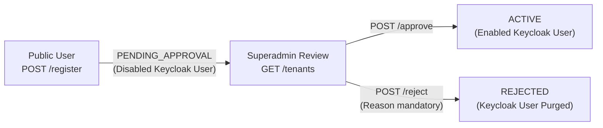

# NextTurn - Tenant Module API Test Plan

This document outlines the end-to-end verification and testing procedures for the **Tenant Management & Onboarding** module (covering requirements **REQ-TNT-01** through **REQ-TNT-06**).

---

## 1. Test Environment & Base URLs

- **Interactive API Documentation (Scalar UI)**: [http://localhost:8080/docs](http://localhost:8080/docs)
- **Interactive Swagger UI**: [http://localhost:8080/swagger-ui/index.html](http://localhost:8080/swagger-ui/index.html)
- **OpenAPI v3 Spec (JSON)**: [http://localhost:8080/v3/api-docs](http://localhost:8080/v3/api-docs)
- **Base API Endpoint**: `http://localhost:8080` (or `http://ryan-a1:8080` on VM)

---

## 2. Authentication & JWT Tokens

NextTurn enforces Role-Based Access Control (**RBAC**). Administrative tenant operations require a Keycloak access token with `SUPERADMIN` client role.

### Retrieve Tokens via PowerShell Helper

1. **`SUPERADMIN` Token** (Copies token directly to clipboard):
   ```powershell
   powershell -ExecutionPolicy Bypass -File backend/scripts/get-token.ps1 -Role superadmin
   ```
   *In Scalar UI: Click **Authentication** $\rightarrow$ select **BearerAuth** $\rightarrow$ paste token.*

2. **`TENANT_ADMIN` Token** (Used for testing `403 Forbidden` access controls):
   ```powershell
   powershell -ExecutionPolicy Bypass -File backend/scripts/get-token.ps1 -Role admin -TenantCode shop-b
   ```

---

## 3. Test Cases Matrix

### Phase 1: REQ-TNT-01 — Tenant Provisioning (Superadmin)

#### TC-TNT-01: Provision a New Clinic Facility
- **Method & URL**: `POST /api/v1/central/tenants`
- **Auth**: `SUPERADMIN`
- **Request Body**:
  ```json
  {
    "tenantCode": "viet-duc-clinic",
    "tenantName": "Phòng Khám Đa Khoa Việt Đức",
    "adminEmail": "admin@vietduc.internal",
    "phoneNumber": "0988112233",
    "maxStaffs": 20,
    "dailyTicketQuota": 300,
    "maxServices": 15,
    "maxAppointments": 150
  }
  ```
- **Expected Status**: `201 Created`
- **Verification**:
  - `data.status` is `"ACTIVE"`.
  - Database schema `tenant_viet-duc-clinic` is initialized with all tenant tables.
  - Organization and administrator account are created in Keycloak.

#### TC-TNT-02: [Negative] Reject Duplicate Identifier
- **Method & URL**: `POST /api/v1/central/tenants`
- **Auth**: `SUPERADMIN`
- **Request Body**: Duplicate payload from TC-TNT-01.
- **Expected Status**: `409 Conflict` (`TENANT_002` or `TENANT_003`).

---

### Phase 2: REQ-TNT-02 — Profile & Operational Quotas

#### TC-TNT-03: Retrieve Tenant Details
- **Method & URL**: `GET /api/v1/central/tenants/viet-duc-clinic`
- **Auth**: `SUPERADMIN`
- **Expected Status**: `200 OK`
- **Verification**: Returns profile info, quota metrics, and `activeStaff: 0`.

#### TC-TNT-04: Update Profile and Capacity Quotas
- **Method & URL**: `PUT /api/v1/central/tenants/viet-duc-clinic`
- **Auth**: `SUPERADMIN`
- **Request Body**:
  ```json
  {
    "tenantName": "Bệnh Viện Đa Khoa Quốc Tế Việt Đức",
    "phoneNumber": "0988999888",
    "maxStaffs": 50,
    "dailyTicketQuota": 1000,
    "maxServices": 30,
    "maxAppointments": 500
  }
  ```
- **Expected Status**: `200 OK`

#### TC-TNT-05: Update Quotas with Unlimited Capacity (`-1`)
- **Method & URL**: `PUT /api/v1/central/tenants/viet-duc-clinic/quotas`
- **Auth**: `SUPERADMIN`
- **Request Body**:
  ```json
  {
    "maxStaffs": 100,
    "dailyTicketQuota": -1,
    "maxServices": -1,
    "maxAppointments": -1
  }
  ```
- **Expected Status**: `200 OK` (`-1` represents unlimited quota).

---

### Phase 3: REQ-TNT-03 — Strict Status Transitions & Soft-Delete

Allowed State Machine:
- `ACTIVE` $\rightarrow$ `SUSPENDED`
- `SUSPENDED` $\rightarrow$ `ACTIVE`
- `PENDING_APPROVAL` $\rightarrow$ `ACTIVE` (via Approve) or `REJECTED` (via Reject)

#### TC-TNT-06: Suspend an Active Tenant
- **Method & URL**: `POST /api/v1/central/tenants/viet-duc-clinic/suspend`
- **Auth**: `SUPERADMIN`
- **Expected Status**: `200 OK`
- **Verification**: `status` becomes `"SUSPENDED"`; Keycloak sessions and logins are disabled.

#### TC-TNT-07: [Negative] Suspend an Already Suspended Tenant
- **Method & URL**: `POST /api/v1/central/tenants/viet-duc-clinic/suspend`
- **Auth**: `SUPERADMIN`
- **Expected Status**: `400 Bad Request` (`TENANT_017` - Tenant is already suspended).

#### TC-TNT-08: Reactivate Suspended Tenant
- **Method & URL**: `POST /api/v1/central/tenants/viet-duc-clinic/activate`
- **Auth**: `SUPERADMIN`
- **Expected Status**: `200 OK`
- **Verification**: `status` returns to `"ACTIVE"`; Keycloak credentials are re-enabled.

#### TC-TNT-09: [Negative] Reactivate an Already Active Tenant
- **Method & URL**: `POST /api/v1/central/tenants/viet-duc-clinic/activate`
- **Auth**: `SUPERADMIN`
- **Expected Status**: `400 Bad Request` (`TENANT_018` - Tenant is already active).

#### TC-TNT-10: Soft-Delete Tenant
- **Method & URL**: `DELETE /api/v1/central/tenants/viet-duc-clinic`
- **Auth**: `SUPERADMIN`
- **Expected Status**: `200 OK`
- **Verification**: Marked with `is_deleted = true`. Subsequent `GET` returns `404 Not Found` (`TENANT_001`). Hard deletion is refused if historical queue tickets or appointments exist (`TENANT_014`).

---

### Phase 4: REQ-TNT-04 — Search & Telemetry Decoration

#### TC-TNT-11: Search & Filter with Pagination
- **Method & URL**: `GET /api/v1/central/tenants?keyword=spa&status=ACTIVE&page=0&limit=10&sortBy=createdAt&sortDirection=DESC`
- **Auth**: `SUPERADMIN`
- **Expected Status**: `200 OK`
- **Verification**: Returns `pagination` envelope and live computed `activeStaff` and `todayTickets` metrics via Valkey cache.

---

### Phase 5: REQ-TNT-05 & REQ-TNT-06 — Public Registration & Review Workflow



#### TC-TNT-12: Public Self-Registration (REQ-TNT-05)
- **Method & URL**: `POST /api/v1/public/tenants/register`
- **Auth**: None (Public endpoint)
- **Request Body**:
  ```json
  {
    "tenantCode": "an-phuoc-hospital",
    "tenantName": "Bệnh Viện Quốc Tế An Phước",
    "adminEmail": "director@anphuoc.hospital",
    "phoneNumber": "0903334455"
  }
  ```
- **Expected Status**: `201 Created`
- **Verification**:
  - `status` is `"PENDING_APPROVAL"`.
  - Staged administrator user in Keycloak has `enabled: false`.

#### TC-TNT-13: [Negative] Reject Registration Without Reason (REQ-TNT-06)
- **Method & URL**: `POST /api/v1/central/tenants/an-phuoc-hospital/reject`
- **Auth**: `SUPERADMIN`
- **Request Body**:
  ```json
  {
    "rejectionReason": "   "
  }
  ```
- **Expected Status**: `400 Bad Request` (`TENANT_020` - Rejection reason cannot be blank).

#### TC-TNT-14: Reject Registration with Mandatory Reason (REQ-TNT-06)
- **Method & URL**: `POST /api/v1/central/tenants/an-phuoc-hospital/reject`
- **Auth**: `SUPERADMIN`
- **Request Body**:
  ```json
  {
    "rejectionReason": "Giấy phép hành nghề y tế cung cấp không trùng khớp thông tin doanh nghiệp."
  }
  ```
- **Expected Status**: `200 OK`
- **Verification**: `status` becomes `"REJECTED"`; staged Keycloak account is purged.

#### TC-TNT-15: Approve Registration Application (REQ-TNT-06)
1. Submit new registration: `POST /api/v1/public/tenants/register` (`tenantCode: "an-phuoc-center"`, `adminEmail: "director@anphuoc.center"`).
2. Approve application:
   - **Method & URL**: `POST /api/v1/central/tenants/an-phuoc-center/approve`
   - **Auth**: `SUPERADMIN`
- **Expected Status**: `200 OK`
- **Verification**: `status` transitions to `"ACTIVE"`; Keycloak user account is enabled (`enabled: true`); welcome email dispatched.

---

### Phase 6: Security & Role Guard Verification

| Test Scenario | Target Endpoint | Token Used | Expected HTTP Status |
| :--- | :--- | :--- | :--- |
| **No Authentication** | `GET /api/v1/central/tenants` | None | `401 Unauthorized` |
| **Malformed Token** | `POST /api/v1/central/tenants` | `Bearer invalid_jwt` | `401 Unauthorized` |
| **Forbidden Role** | `POST /api/v1/central/tenants` | `TENANT_ADMIN` token | `403 Forbidden` |
| **Forbidden Role** | `DELETE /api/v1/central/tenants/{id}` | `COUNTER_STAFF` token | `403 Forbidden` |

